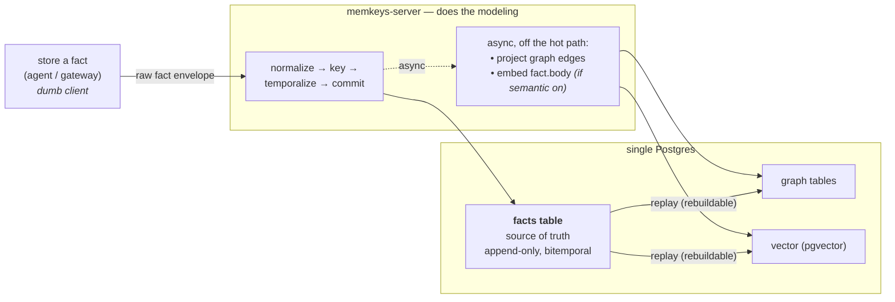
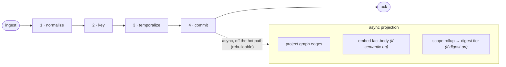

# Architecture

This page is the end-user tour of how MemKeys is put together. The authoritative,
fully-detailed design (with the ADR decision log) lives in
[`docs/architecture.md`](https://github.com/MemKeys/memkeys/blob/main/docs/architecture.md); here we condense it to what you need
to run and build against MemKeys.

The system is three storage layers and four retrieval operations, all on top of a
**single Postgres**. One idea runs through all of it — the
[keyed-first invariant](./what-is-memkeys.md#the-keyed-first-invariant): the keyed /
temporal store is the source of truth, and graph and vector are derived views.



## The fact envelope

A producer pushes a **raw** fact. The envelope carries *hints*, not authority — the
server is the authority on keys, time, and supersession.

```jsonc
{
  "source": {
    "kind": "gateway_flush | run_settle | a2a_exchange | telemetry_learning", // REQUIRED
    "producer": "<agent or gateway id>",  // advisory — server-verified against the caller
    "emitted_at": "<RFC3339 timestamp>"   // REQUIRED — client clock; defaults fact.event_time
  },
  "entity": {                 // KEY HINTS — validated/enriched server-side; send AT LEAST this source's anchor
    "project": "<id>", "issue": "<id>", "pr": "<id>",
    "agent":   "<id>",        // = the authenticated producer agent (server-verified)
    "run":     "<id>",        // anchor for gateway_flush / run_settle
    "thread":  "<id>",        // anchor for a2a_exchange
    "service": "<id>"         // anchor for telemetry_learning (server maps service → project)
  },
  "fact": {
    "type": "decision | outcome | observation | learning | context", // optional — defaults per source.kind
    "body": "<natural-language text OR structured payload>",          // REQUIRED — the one thing only the producer knows
    "subject": "<the thing within the entity this fact is about>",    // optional; REQUIRED when `supersedes` is set
    "event_time": "<optional RFC3339; when it happened; defaults to emitted_at>",
    "confidence": 0.0,        // optional; SHOULD be set for type=learning
    "supersedes": "<optional prior fact id this fact replaces>"
  },
  "provenance": { },          // MUST be absent — server strips & stamps principal/custody/trace
  "attachments": [ ]          // optional refs (doc ids, blob uris) — never inlined
}
```

The contract that makes this work:

- **Raw in, modeled server-side.** The producer never computes keys, validity
  windows, or embeddings. It reports what it saw.
- **One mandatory anchor per source.** Each source sends only the one key it
  natively knows — `run` for gateway-flush and run-settle, `thread` for A2A,
  `service` **or** `project` for telemetry — and the server enriches the rest
  (a `run` resolves to its project/issue/pr/agent; a `thread` to its work item and
  participants). A dumb client pushes its run id and still produces a fully-keyed
  fact.
- **`fact.body` is the only always-required payload.** `fact.type` is optional and
  defaults per `source.kind` (gateway_flush → context, run_settle → outcome,
  a2a_exchange → observation, telemetry_learning → learning).
- **`entity.agent` is always the authenticated producer** — never taken on a
  client's say-so about another agent. `provenance` is server-owned and discarded if
  a client populates it.
- **`subject` is the supersession grain.** It groups successive versions of the same
  statement (e.g. "the chosen database") and is required whenever `supersedes` is
  set — you cannot version a statement without naming it.

A fact that resolves to **no** durable key is still stored, but tagged `unkeyed` and
reachable only through semantic search — it never pollutes a keyed result set.
Key-dropping is never silent: an un-resolvable asserted key is recorded as a
rejected hint on the fact.

## Keyed-first retrieval

Most reads are deterministic lookups, so the default path is a **keyed fetch**: give
one or more entity keys plus an optional time range, and get back every currently-valid
fact about them. No embeddings, no graph traversal — a filtered, indexed scan.

Supersession is resolved at **read time**: the fetch returns the latest
non-superseded record per `(entity, subject, type)` by default (`valid=current`), or
the full history with `valid=all`, or a point-in-time snapshot with `as_of`. Semantic
search is only reached for the open-ended question, and even then it is bounded by the
caller's tenant and any entity scope the caller names (see the
[four-op contract](#the-four-operation-contract)).

## Single-Postgres layout

MemKeys runs on **one Postgres instance** — the
[reference architecture](https://github.com/MemKeys/memkeys/blob/main/docs/architecture.md) deliberately avoids a second datastore.
Everything lives there:

- **The fact store (source of truth).** An append-only, bitemporal table of fact
  records: the body, type, subject, confidence, the first-class entity dimensions
  (`project` / `issue` / `pr` / `agent` / `run` / `thread`), provenance, and a
  `keyed` flag. Entity columns are indexed filter targets — that is the keyed hot
  path. Nothing here is ever updated in place; a new version is a new row that points
  at the one it supersedes.
- **The graph tables (derived).** Entity nodes and typed edges (`entity_fact`,
  `supersedes`, `produced_by`, `temporal`, `a2a_participant`) projected from the fact
  store, used by graph traversal. Rebuildable by replay.
- **The vector index (derived, optional).** When the semantic module is enabled,
  fact-body embeddings are stored with [**pgvector**](https://github.com/pgvector/pgvector)
  in the same database and searched with approximate nearest-neighbour. An optional
  second "digest" tier embeds scope-level rollup summaries for navigational recall.

> **pgvector is required.** A boot migration runs `CREATE EXTENSION vector`. A stock
> `postgres:*` image does not ship pgvector, so the server **preflights** the
> extension at startup and exits with a clear message rather than failing mid-migration.
> Use a pgvector-enabled image (e.g. `pgvector/pgvector:pg18`) or a managed Postgres
> with pgvector available — see [Getting started](./getting-started.md).

Keeping the derived views in the same Postgres is what makes a single-node deployment
genuinely single-node: one connection string, one backup, one thing to operate.

## The write pipeline

A write runs four **synchronous** stages, then hands off to **async** projection:



1. **Normalize** — validate the envelope, canonicalize `fact.type`, stamp
   `ingested_at`, assign a stable `fact.id` (the idempotency key, so a retried flush
   never duplicates).
2. **Key** — resolve entity keys (verify from the caller → enrich from the run/thread
   registry → accept low-trust hints), mark `keyed`, attach any rejected hints.
3. **Temporalize** — set the event-time axis; if `supersedes` is set, validate the
   target shares `(entity, subject, type)`. Supersession is computed at read time, so
   there is no write-back.
4. **Commit** — write the authoritative record. **This is the commit point**: the
   `ack` returns as soon as the keyed write succeeds.

The agent's write latency depends on stages 1–4 **only**. Graph projection and
embedding run afterwards, off the hot path, each idempotent on `fact.id` and
rebuildable. A background reconciler detects projection lag or holes and rebuilds
them, and projection lag is an observable metric — so a derived view can never
silently diverge from the source of truth.

## The four-operation contract

All four operations return the same **fact shape** — the authoritative record,
hydrated from the keyed store. Graph and search carry ids, never body text; the
keyed store is always the final authority, which is what lets callers mix operations
and still get coherent results.

### 1. Write with keys

```
POST /memory/facts
     { …envelope… }
  → { fact.id, keyed, entity_keys_resolved: {…} }
```

The response echoes the server-resolved keys so the caller can cache them for
subsequent reads without a lookup round-trip.

### 2. Fetch by keys

```
GET /memory/facts
    ?entity.issue=…  &entity.pr=…  &entity.agent=…  &entity.run=…  &entity.project=…
    &type=decision|outcome|observation|learning|context   (optional)
    &as_of=<RFC3339>    (optional; point-in-time replay)
    &valid=current|all  (default current — collapses supersession)
    &limit=…
  → { facts: [ { fact.id, type, subject, body, confidence, entity, event_time, provenance } ] }
```

At least one `entity.*` key is required; multiple keys are ANDed (intersection).

### 3. Graph traversal

```
POST /memory/graph/traverse
     { "start": { "kind": "fact|entity", "id": "…" },
       "edges": ["supersedes","entity_fact","produced_by","temporal","a2a_participant"],
       "direction": "out|in|both",
       "depth": 2,
       "hydrate": true }     // fetch bodies from the keyed store for leaf nodes
  → { nodes: [...], edges: [ { from, to, type } ] }
```

`edges` is a filter — omit it to walk all edge types. `hydrate: false` returns graph
structure only.

### 4. Semantic search (optional module)

```
POST /memory/search
     { "query": "<text>",
       "scope": { "entity.project": "…", "entity.issue": "…", "fact.type": "…", "category": "…" },
       "k": 10,
       "tiers": "auto|fact|digest",   // default auto
       "as_of": "<RFC3339>" }
  → { hits: [ { fact.id, score, type, subject, body, entity, event_time, via } ] }
```

Search is always **scoped to the caller's tenant** — never global. A search with no
finer `entity.*` filter runs against everything the caller's tenant owns (including
`unkeyed` facts); finer filters narrow *within* that tenant floor. When both vector
tiers are on, results are fused with Reciprocal Rank Fusion and every hit resolves
down to its underlying authoritative fact — a digest summary is never the answer.
When the semantic module is disabled the endpoint returns `501 feature_disabled`
rather than a silently empty result, so callers can degrade gracefully.

## Tenancy and the current auth posture

The governing invariant is that the tenant floor is derived from the **authenticated
principal** — never supplied by, nor omittable by, the client. When the server is
configured with a run-token verifier (`MEMKEYS_RUN_TOKEN_SECRET`), the HTTP transport
verifies a per-request `Authorization: Bearer <jwt>` and derives the tenant
server-side; the `X-MemKeys-Tenant` header is honoured only as an intersect-only
narrower that must equal the principal's tenant.

Without a verifier, the server runs in **open loopback dev mode**: the tenant is
self-asserted via the `X-MemKeys-Tenant` header. To keep that surface off the
network, the server **binds `127.0.0.1` by default** and *refuses to start* on a
non-loopback address unless either a verifier is configured or
`MEMKEYS_ALLOW_INSECURE=1` is set explicitly (which also logs a loud warning). Run
single-tenant / trusted-loopback deployments freely; do not expose an unverified
server to mutually-distrusting tenants on a shared bind. See
[`docs/architecture.md` §7.6](https://github.com/MemKeys/memkeys/blob/main/docs/architecture.md) for the full discussion.
